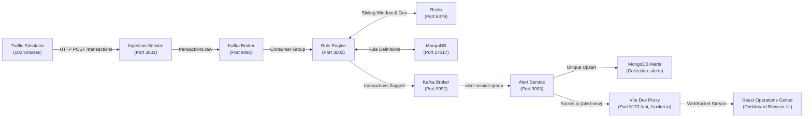
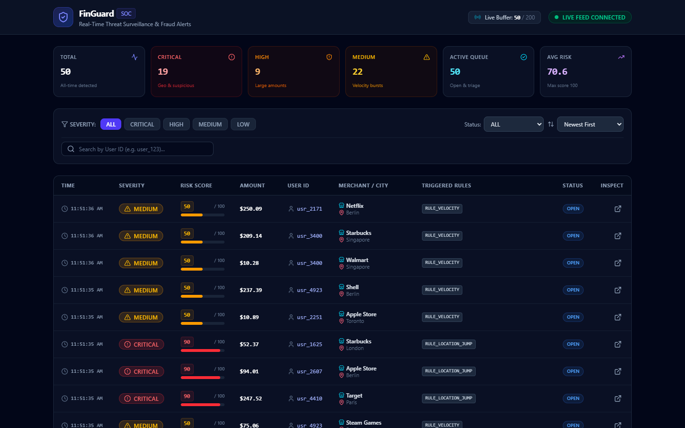
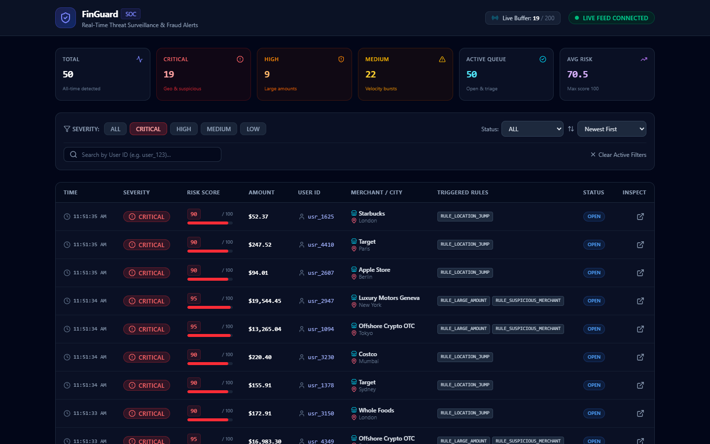
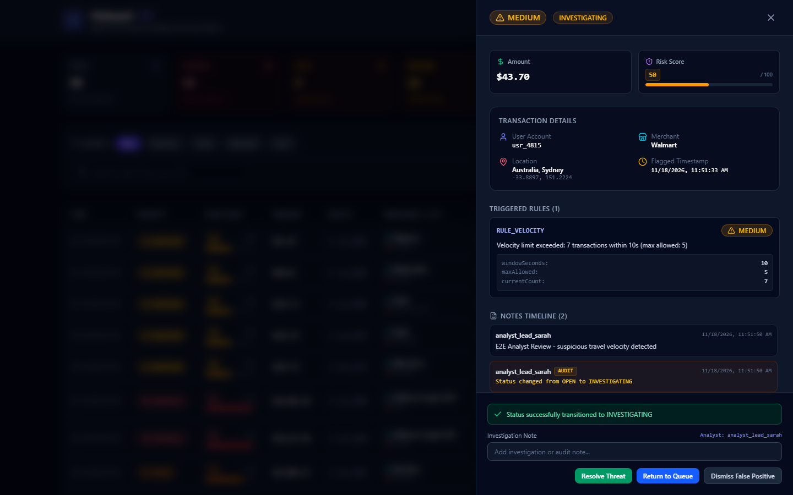
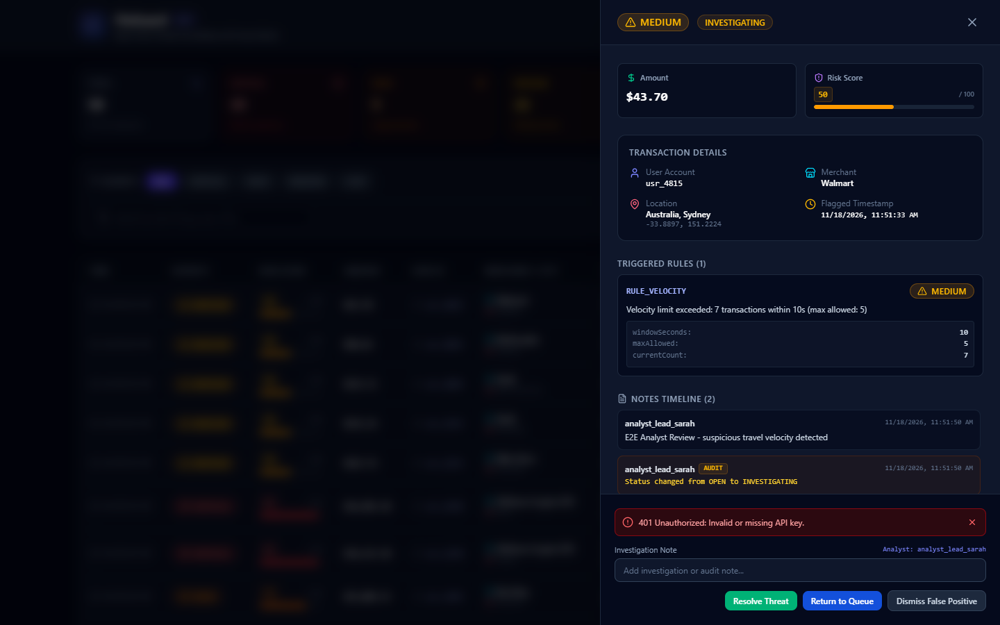

# FinGuard - Real-Time Financial Fraud Detection Platform

FinGuard is a high-volume financial transaction ingestion and real-time fraud detection engine built with an event-driven microservices architecture on the MERN stack.

## Architecture & Tech Stack

- **Runtime & Framework**: Node.js (v20+), Express (CommonJS)
- **Streaming & Messaging**: Apache Kafka in KRaft mode (no ZooKeeper) via `kafkajs`
- **Databases & Caching**: MongoDB 7.0 (Mongoose) for persistence, Redis 7 (`ioredis`) for sliding-window velocity checks
- **Validation & Logging**: Joi for schema validation, `pino` for structured JSON logging
- **Infrastructure**: Docker & Docker Compose with healthchecks and named volumes
- **Testing**: Jest & Supertest

## Monorepo Layout

```
finguard/
  ├── services/
  │   ├── ingestion/       # HTTP Ingestion API (POST /transactions & /batch) -> Kafka
  │   ├── rule-engine/     # Stateful fraud evaluation service & at-least-once Kafka processor
  │   ├── alert/           # Alert persistence and notifications (skeleton)
  │   ├── auth/            # Authentication & authorization service (skeleton)
  │   └── gateway/         # API Gateway & reverse proxy (skeleton)
  ├── simulator/           # High-volume traffic generator CLI with reproducible fraud patterns
  ├── shared/              # Reusable logger, Kafka wrappers, schemas, constants
  ├── infra/               # Docker Compose & infrastructure configurations
  ├── docs/                # Architectural diagrams & design specifications
  ├── scripts/             # End-to-end verification scripts
  ├── .gitignore
  ├── .env.example
  └── README.md
```

## Phase 1 Milestones

- [x] **Day 1: Setup & Architecture**
  - Monorepo folder structure and service initialization
  - Docker Compose for KRaft Kafka, MongoDB 7.0, and Redis 7
  - Kafka topics auto-creation (`transactions.raw`, `transactions.flagged`)
  - Canonical transaction schema definition in `shared/`
  - Structured Pino logger and environment templates
- [x] **Day 2: Service Skeletons & Kafka Wrapper**
  - Express service skeletons with `GET /health`, env config, and graceful shutdown
  - Clear `src/` layout (routes, controllers, services, config) across all 5 microservices
  - Reusable resilient Kafka wrapper (`createProducer`, `createConsumer`) with retry & backoff
  - Live Kafka roundtrip verification against Docker Compose cluster
  - Automated Jest & Supertest health check test suite
- [x] **Day 3: Ingestion Service & Transaction Simulator**
  - High-throughput `POST /transactions` validating schema with Joi and publishing to `transactions.raw` keyed by `userId`
  - High-performance `POST /transactions/batch` with 500-item cap, per-item error indexing, and single `producer.sendBatch` publishing
  - Comprehensive Jest & Supertest validation test suite
  - Configurable transaction simulator CLI with reproducible seedable fraud patterns
  - End-to-end load verification at 100 txns/sec for 30s (~3,000 transactions into Kafka)

## Phase 2 Milestones

- [x] **Day 4: Real-Time Rule Engine & At-Least-Once Processing**
  - Kafka stream consumer subscribing to `transactions.raw` with configurable `fromBeginning=false`
  - Resilient, poison-pill-proof message handling (malformed JSON and schema failures logged and skipped without blocking partition)
  - At-least-once delivery: manual offset commit only after confirmed publication of flagged event to `transactions.flagged`
  - Seed fraud rules matching traffic patterns:
    - `RULE_LARGE_AMOUNT`: Amount > $10,000 USD (Severity: HIGH)
    - `RULE_SUSPICIOUS_MERCHANT`: Regex matching luxury, offshore, and casino merchants (Severity: CRITICAL)
  - Live end-to-end benchmark verification: consumed 2,999 raw transactions, flagged and published 66 fraud events with full rule metadata
- [x] **Day 5: Stateful Velocity & Geo-Distance Rules + Atomic Runtime Reload**
  - **MongoDB Rule Persistence**: Fraud rules stored in MongoDB collection `rules` with automatic fallback seeding if collection is empty.
  - **Standardized Severity**: Standardized across schema, model, evaluator, and alerts as `LOW`, `MEDIUM`, `HIGH`, `CRITICAL`.
  - **Redis Sliding-Window Velocity (`RULE_VELOCITY`)**: Tracks per-user frequency using Redis Sorted Sets (`ZADD`, `ZREMRANGEBYSCORE`, `ZCARD`) within a sliding window (default: > 5 txns in 10s) with TTL auto-expiration.
  - **Geo-Distance & Impossible Travel (`RULE_LOCATION_JUMP`)**: Haversine distance and implied speed calculation (> 900 km/h) with rapid country change detection. Gracefully handles user's first transaction without false positives.
  - **Atomic Runtime Reload**: Rebuilds `RuleEvaluator` instance atomically so no transaction evaluates against partial state. Triggers immediately via Redis Pub/Sub channel `rules:updated` or HTTP `PATCH /rules/:id`, plus a 60-second fallback poll.
- [x] **Day 6: Complete Rules CRUD API & Advanced Validation**
  - **Full REST CRUD Management**: `POST /rules`, `GET /rules`, `GET /rules/:id`, `PUT /rules/:id`, `DELETE /rules/:id`, `PATCH /rules/:id/toggle`.
  - **Type-Specific Joi Validation**: Strict schemas for `amount_threshold`, `merchant_regex`, `velocity`, and `geo_jump` with structured fields only (disallowing arbitrary code injection and `eval()`).
  - **ReDoS Protection**: Pattern compilation validation and AST vulnerability analysis via `safe-regex2` with length caps ($\le 500$ chars) rejecting catastrophic backtracking patterns.
  - **Severity-Scaled Risk Scoring**: Scaled as `LOW: 25`, `MEDIUM: 50`, `HIGH: 75`, `CRITICAL: 90`, plus $+5$ bonus per extra matched rule (capped at 100).
  - **Simulator User Pool Scaling**: Added `--users` flag (default 5,000) eliminating velocity false positives for normal users.
  - **Pub/Sub Live Mutation**: Every CRUD and toggle operation broadcasts to Redis `rules:updated` for zero-downtime atomic engine reload. Verified live with new rule creation.

## Phase 3 Milestones

- [x] **Day 7: Real-Time Alert Service, Socket.io Streaming & Audit Lifecycle**
  - **Kafka Flagged Consumer (`alert-service-group`)**: Subscribes to `transactions.flagged` with `fromBeginning=false` and strict post-persistence offset commit ordering.
  - **Poison-Pill Protection**: Non-JSON and schema-invalid messages logged and committed without blocking partition pipelines.
  - **Idempotent Persistence Layer**: Database-level unique index on `txnId` + `$setOnInsert` atomic upserts eliminate duplicate alert storage and prevent duplicate WebSocket alerts under at-least-once Kafka retries.
  - **Highest-Severity Resolution**: Computed dynamically as $\text{CRITICAL} > \text{HIGH} > \text{MEDIUM} > \text{LOW}$.
  - **Socket.io Real-Time Streaming**: Dispatches `alert:new` events with full alert payload to connected dashboard operators. Supports severity room subscriptions (`severity:CRITICAL`, `severity:HIGH`) and active connection metrics.
  - **REST Management & $facet Aggregation**:
    - `GET /alerts/stats`: Registered before `/:id` to prevent route shadowing; returns total, breakdown by severity, breakdown by status, top 5 rules, and average risk score in a single atomic database query.
    - `GET /alerts`: Whitelisted Joi pagination (max 100 limit), sorting, and strict query filters (`severity`, `status`, `userId`, `ruleId`, date ranges) rejecting NoSQL injections.
    - `GET /alerts/:id`: Resolves by UUID `alertId` or 24-character MongoDB `_id` with 400/404 handling.
    - `PATCH /alerts/:id/status`: Constant-time API key authorization (`x-api-key`), enforcing status state machine transitions with automated analyst audit log entries.
  - **End-to-End Live Verification**: Verified 100% pipeline consistency (Rule Engine Flagged: 76 == MongoDB Alerts: 76 == Socket.io Events: 76) with live deduplication and audit tracking.

---

## Transaction Ingestion API

The Ingestion Service exposes two endpoints on port `3001`:

### 1. Single Transaction Ingestion
- **Endpoint**: `POST /transactions`
- **Headers**: `Content-Type: application/json`
- **Responses**:
  - `202 Accepted`: Payload validated and queued to Kafka topic `transactions.raw` partitioned by `userId`.
  - `400 Bad Request`: Validation failure with structured field errors.

### 2. Bulk Transaction Ingestion
- **Endpoint**: `POST /transactions/batch`
- **Batch Size Limit**: Max 500 transactions per batch.
- **Responses**:
  - `202 Accepted`: All items valid and published in a single Kafka `sendBatch` call.
  - `202 Accepted` (`status: partially_accepted`): Valid items published via `sendBatch`, with per-item validation errors specifying each bad item's index.
  - `400 Bad Request`: If empty, over 500 items, or all items invalid.

---

## Rule Engine Service

The Rule Engine runs on port `3002` and consumes `transactions.raw` in real-time:

### Endpoints
- `GET /health`: Service health and live processor metrics (total consumed, flagged, clean, malformed).
- `POST /rules`: Create a new rule with type-specific Joi validation and ReDoS protection.
- `GET /rules`: List all configured fraud rules from MongoDB.
- `GET /rules/:id`: Fetch a single rule's complete configuration.
- `PUT /rules/:id`: Update an existing rule's configuration.
- `DELETE /rules/:id`: Delete a rule from MongoDB and atomically reload memory.
- `PATCH /rules/:id/toggle`: Toggle rule active status (`enabled: true/false`).
- `PATCH /rules/:id`: Partial rule update (convenience endpoint).

### Active Seed Rules
| Rule ID | Type | Severity | Description | Default Threshold / Window |
|---|---|---|---|---|
| `RULE_LARGE_AMOUNT` | `amount_threshold` | `HIGH` | Flags transactions with amount > threshold in USD | Amount > $10,000 USD |
| `RULE_SUSPICIOUS_MERCHANT` | `merchant_regex` | `CRITICAL` | Flags transactions at luxury, offshore crypto, or casino merchants | Regex pattern match |
| `RULE_VELOCITY` | `velocity` | `MEDIUM` | Flags rapid bursts of transactions from a single user | > 5 txns within 10 seconds |
| `RULE_LOCATION_JUMP` | `geo_jump` | `CRITICAL` | Flags impossible travel between distant locations/countries | > 900 km/h or cross-country < 300s |

---

## Alert & Notification Service

The Alert Service runs on port `3003`, consuming `transactions.flagged` and broadcasting live alerts to UI dashboards:

### REST Endpoints
- `GET /health`: Service health, consumer metrics, and active WebSocket connection count.
- `GET /alerts/stats`: Aggregated metrics via single `$facet` pipeline (total, bySeverity, byStatus, topRules, avgRiskScore). Registered before `/:id`.
- `GET /alerts`: Paginated list of alerts (page, limit $\le 100$, sort by `createdAt` or `riskScore`) with strict whitelisted filters (`severity`, `status`, `userId`, `ruleId`, `startDate`, `endDate`).
- `GET /alerts/:id`: Fetch alert by UUID `alertId` or 24-character MongoDB `_id`.
- `PATCH /alerts/:id/status`: Transition alert status with API key authorization (`x-api-key`). Automatically appends custom analyst notes and audit log entries.

### Alert Lifecycle Transitions
| Current Status | Allowed Target Statuses | Rules & Rationale |
|---|---|---|
| `OPEN` | `INVESTIGATING`, `DISMISSED` | Analysts claim for review or fast-dismiss benign patterns. |
| `INVESTIGATING` | `RESOLVED`, `DISMISSED`, `OPEN` | Confirm fraud, clear false-positive, or return to unassigned triage pool. |
| `RESOLVED` | `INVESTIGATING` | **Reopen allowed**: Triggered on customer disputes or chargebacks. Direct transition to `OPEN` prohibited. |
| `DISMISSED` | `INVESTIGATING` | **Reopen allowed**: Triggered on audit escalations or false-negatives. Direct transition to `OPEN` prohibited. |

### Real-Time Socket.io Events
- **Server Port**: `3003` (CORS restricted to `DASHBOARD_ORIGIN`)
- **Event**: `alert:new`
- **Default Stream**: All connected clients receive all alerts via `all-alerts` channel.
- **Severity Room Subscriptions**: Clients emit `subscribe` with room name (e.g. `severity:CRITICAL`, `severity:HIGH`) to isolate specific severity tiers without receiving duplicate broadcasts.
- **Payload Schema**:
  ```json
  {
    "alertId": "uuid-v4",
    "txnId": "uuid-v4",
    "userId": "usr_12345",
    "amount": 15000,
    "currency": "USD",
    "merchant": "Rolex Boutique",
    "location": { "city": "Geneva", "country": "CH", "lat": 46.2, "lng": 6.14 },
    "matchedRules": [
      {
        "ruleId": "RULE_LARGE_AMOUNT",
        "ruleName": "High Transaction Amount",
        "severity": "HIGH",
        "reason": "Amount > 10000"
      }
    ],
    "riskScore": 75,
    "severity": "HIGH",
    "status": "OPEN",
    "flaggedAt": "2026-11-18T04:19:20.000Z",
    "createdAt": "2026-11-18T04:19:20.015Z"
  }
  ```

---

## FinGuard Real-Time Operations Dashboard (`frontend/`)

A React 19 + Vite 8 + Tailwind CSS frontend dashboard providing fraud analysts with live threat surveillance, metrics, and incident triage.

### End-to-End Streaming Architecture



### Quick Start
```bash
# 1. Start core infrastructure (Kafka, MongoDB, Redis)
npm run infra:up

# 2. Start backend microservices (in separate terminals or dev mode)
node services/alert/src/index.js       # Port 3003
node services/rule-engine/src/index.js  # Port 3002
node services/ingestion/src/index.js    # Port 3001

# 3. Start frontend dev server on http://localhost:5173
npm run dashboard:dev

# 4. Generate transaction traffic
npm run simulate -- --rate 100 --duration 30 --users 5000
```

### Architecture & Capabilities
- **Live WebSocket Feed**: Connects to Alert Service via Vite Dev Proxy (`http://localhost:5173/socket.io`) with automatic reconnect, exponential backoff (1s - 5s max), and live reactive connection badge (`LIVE FEED CONNECTED`, `RECONNECTING...`, `DISCONNECTED`).
- **Throttled 250ms Batch Ingestion & 200 FIFO Ring Buffer**: Live feed buffers incoming events and flushes to React state in 250ms intervals, deduplicating incoming events and maintaining a strict 200 in-memory FIFO cap.
- **Severity Room Isolation**: Switching severity filters (`CRITICAL`, `HIGH`, `MEDIUM`, `LOW`) automatically emits Socket.io `subscribe` / `unsubscribe` commands to isolate target traffic over the wire with 0 leaks and 0 dropped alerts.
- **Authoritative Metrics Cards**: Independent cards for Total, Critical, High, Medium, Active Queue, and Avg Risk Score. Incremented client-side when in `all-alerts` mode, with a periodic 5s/30s background resync via `GET /alerts/stats` against MongoDB.
- **Pagination & Historical Mode**: Page 1 displays real-time live prepending. Navigating to Page > 1 activates `Historical mode`, pausing live prepending to allow uninterrupted review of historical records.
- **Incident Inspection Drawer**: Click any alert row to view metadata, geographic coordinates, triggered rule breakdown with exact parameters (haversine distance, speed, burst count), notes timeline, and state machine transition workflows (`OPEN` -> `INVESTIGATING` -> `RESOLVED` / `DISMISSED`).

### Visual Showcase & Verification Screenshots

#### 1. Real-Time Live Feed Table & Global Metrics


#### 2. Severity Room Filtered View (Pure CRITICAL Threats)


#### 3. Alert Inspection Drawer & Status Lifecycle Mutation


#### 4. API-Key Protected Status Updates & 401 Error Handling


> [!WARNING]
> **Security Notice regarding `VITE_ADMIN_API_KEY`:**
> Any environment variable prefixed with `VITE_` is baked directly into the client-side JavaScript bundle and is visible to any browser visitor. In this development setup, `VITE_ADMIN_API_KEY` is provided in `.env` for local testing only. In production environments, never expose admin keys in the browser bundle; all privileged status modifications must be routed through an authenticated backend-for-frontend (BFF) session or reverse proxy with user-level RBAC.

### Known Limitations

1. **Client-Side Admin API Key (`VITE_ADMIN_API_KEY`)**: In development, privileged alert status updates use a static API key bundled in the Vite environment. In production, this must be replaced by a secure Backend-For-Frontend (BFF) session or reverse-proxy with user-level JWT authentication and role-based access control (RBAC).
2. **Hardcoded Analyst Identity**: The analyst identifier (`analyst_lead_sarah`) is currently hardcoded in `AlertDetailDrawer.jsx` as a placeholder pending user authentication (Auth Service) integration in subsequent milestones.
3. **In-Memory Feed Cap (200 Records)**: To prevent browser DOM bloat and high memory usage, the live feed retains a maximum of 200 alerts in client-side memory. Historical records are preserved in MongoDB and accessible via paginated API queries.
4. **Single-Node Infrastructure**: Apache Kafka, MongoDB, and Redis run in single-node containers in Docker Compose for development efficiency rather than distributed multi-broker clusters.

---

---

## Transaction Simulator CLI

```bash
node simulator/src/index.js [options]
# or using npm
npm run simulate -- [options]
```

| Flag | Description | Default |
|---|---|---|
| `-r, --rate <number>` | Target transactions per second (txns/sec) | `10` |
| `-d, --duration <number>` | Simulation duration in seconds | `10` |
| `--users <number>` | Size of simulated user pool (prevents normal velocity collisions) | `5000` |
| `-s, --seed <string>` | Seed for reproducible random numbers & fraud patterns | *random* |
| `-u, --url <string>` | Target Ingestion endpoint URL | `http://localhost:3001/transactions` |
| `-b, --batch <number>` | Batch size for bulk ingestion | `1` (single POSTs) |
| `--fraud-ratio <number>` | Trigger probability per generator step | `0.05` (5%) |

> **Note on Fraud Ratio vs. Effective Share:**
> The `--fraud-ratio` parameter (default `0.05` or 5%) configures the *trigger probability per generation step*. However, when a `rapid_velocity` anomaly triggers, it generates a multi-transaction burst of 5 to 7 transactions for that user, and a `location_jump` anomaly emits 2 sequential geographically distant transactions. As a result, the **effective fraud-like transaction share** across all generated transactions is approximately **12% to 14%** (around ~13% on average).

---

## Testing & Verification

```bash
# Run test suites across all workspaces
npm test

# Run Kafka end-to-end roundtrip test
npm run test:kafka
```
